# Contribute a blog to Platform Explorers

We welcome practical guides, project stories and experiences from our community.
You can contribute by **emailing a Word document**, using **VS Code on your computer**,
or writing directly on **GitHub in your browser**.

Choose the option that works best for you below.

## What you need

For all three options:

- Your article, a title, a short summary and your author bio.
- Any images you want to use, with permission to publish them and descriptive alt text.

## Option A: contribute by email

Send us your article, blog or project write-up as a Word document. You do not
need a GitHub account, fork, branch or pull request for this option.

1. Write your article, blog or project write-up in a **Word document (.docx)**.
2. Include **all images used in the write-up inside the document**, placed beside
   the text they relate to.
3. Add **your name and a short author bio** at the end of the document.
4. Attach the Word document to an email and send it to  
   [info@platformexplorers.com](mailto:info@platformexplorers.com?subject=Blog%20Contribution)
5. Use **Blog Contribution** as the email subject.

**To:** info@platformexplorers.com  
**Subject:** Blog Contribution

## For VS Code and GitHub: fork the repository

A **fork** is your copy of this repository. A **branch** keeps your article's edits
together. A **pull request (PR)** asks the Platform Explorers team to review those
edits and add them to the website.

The screenshots use a tutorial fork and sample article. Use your own account,
article name and author details. Select an image to view it at full size.

For the VS Code and GitHub options, you also need a free
[GitHub account](https://github.com/signup).

For the VS Code method, install these if you don’t already have them:

- [Git](https://git-scm.com/downloads).
- [Visual Studio Code](https://code.visualstudio.com/).

After installing Git, close and reopen VS Code so its terminal can find Git.
The GitHub-only method needs no local software installation.

Complete this setup for the VS Code or GitHub option.
Email contributors only need the email instructions above.

1. Sign in to GitHub and open
   [PlatformExplorers/platformexplorerswebsite](https://github.com/PlatformExplorers/platformexplorerswebsite).
2. Select **Fork**, choose your own account and select **Create fork**.
3. Your fork should have an address like
   `https://github.com/YOUR-USERNAME/platformexplorerswebsite`.

If you already have a fork, open it, select **Sync fork**, then **Update branch**
before starting a new contribution.


[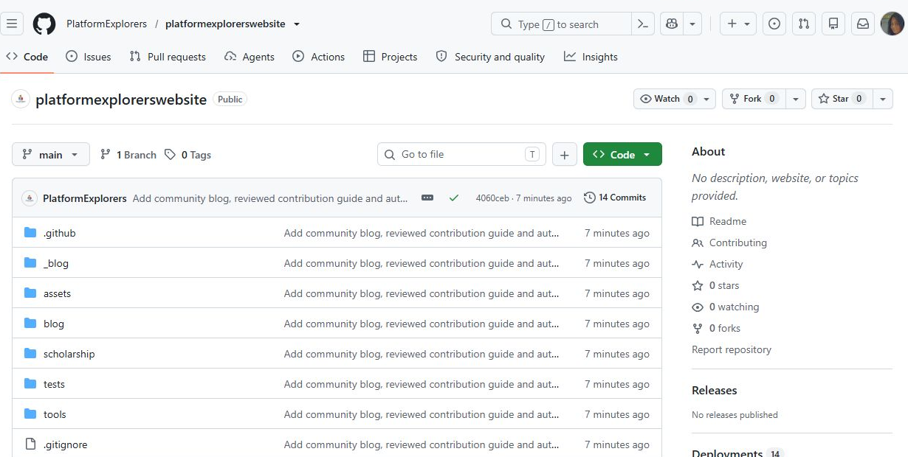](assets/contribution/repository.webp)

*Open the Platform Explorers repository and select Fork.*


[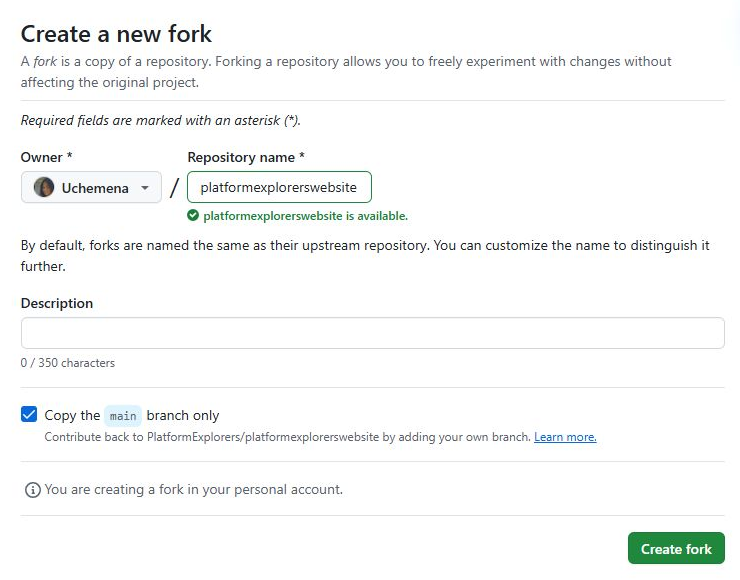](assets/contribution/fork-setup.webp)

*Choose your account as the owner, keep the repository name and select Create fork.*


[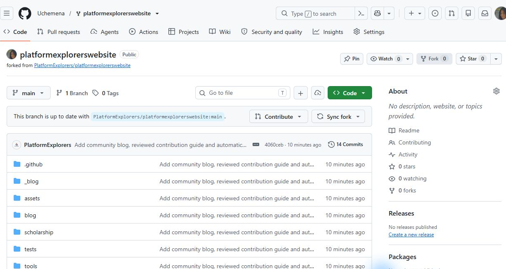](assets/contribution/fork-created.webp)

*Your copy shows your username and a link back to the original repository.*

Choose the VS Code or GitHub option below to continue from your fork.

## Option B: contribute using VS Code

Start after creating your fork in the shared setup above. These screenshots use
`my-first-automation` for the article and `example-contributor` for the author
profile. Replace them with your own names throughout.

### 1. Copy your fork to your computer

1. In **your fork** on GitHub, select **Code**, choose **HTTPS** and copy the URL.

[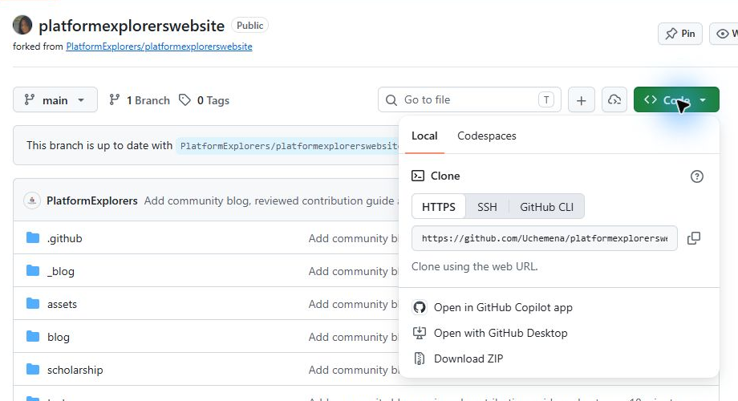](assets/contribution/copy-clone-url.webp)

*Copy the URL from your own fork, not the Platform Explorers repository.*

2. Open **Visual Studio Code**. Select **File > New Window** so you can work in
   a separate window.
3. In that new window, select **Terminal > New Terminal**. The terminal opens
   at the bottom of VS Code. If Terminal is hidden in the top menu, select
   **...** to find it.

[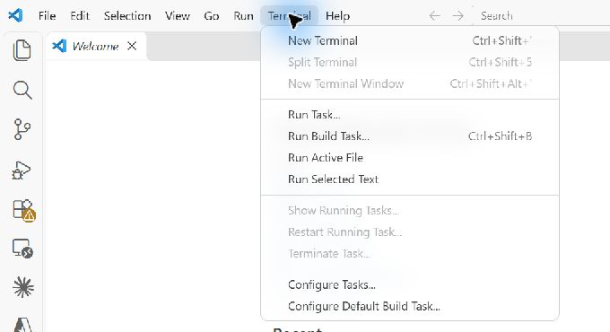](assets/contribution/vscode-terminal-menu.webp)

*Select Terminal, then New Terminal. This is where you enter the commands below.*

4. In the terminal, type `git clone`, add a space, paste the URL you copied,
   then press **Enter**. Replace `YOUR-USERNAME` with your GitHub username:

   ```shell
   git clone https://github.com/YOUR-USERNAME/platformexplorerswebsite.git
   ```

5. Wait until the command finishes and the terminal prompt returns. Git creates
   a folder named `platformexplorerswebsite` inside the terminal's current
   location. To see that location, type `pwd` and press **Enter**.
6. Select **File > Open Folder**. Browse to the location from step 5, open
   `platformexplorerswebsite`, then select **Select Folder** on Windows
   (**Open** on macOS). Open the whole repository folder, not just `blog`.

[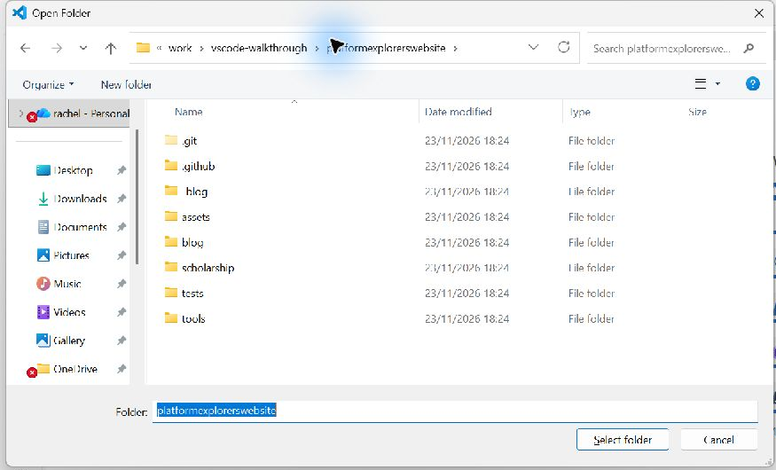](assets/contribution/vscode-open-project.webp)

*Select the cloned platformexplorerswebsite folder. Its files will appear in the Explorer on the left.*

### 2. Create a branch for your article

1. With the repository open, select **Terminal > New Terminal** again. This
   terminal should open inside `platformexplorerswebsite`.
2. Type the command below and press **Enter**:

   ```shell
   git switch -c blog/my-first-automation
   ```

3. Wait for `Switched to a new branch` in the terminal. The branch name also
   appears at the bottom-left of VS Code. Use your own article name instead of
   `my-first-automation`, and use that same name in the folder and commands below.

To make room for writing, select the **Hide Panel (×)** button at the top-right
of the terminal panel. Open a terminal again from **Terminal > New Terminal**
when you reach step 6.

### 3. Create your article folder and Markdown file

1. Select **Explorer** in the left activity bar if the file list is hidden.
2. Right-click the **blog** folder and select **New Folder**. Use `blog`,
   not the separate `_blog` folder.

[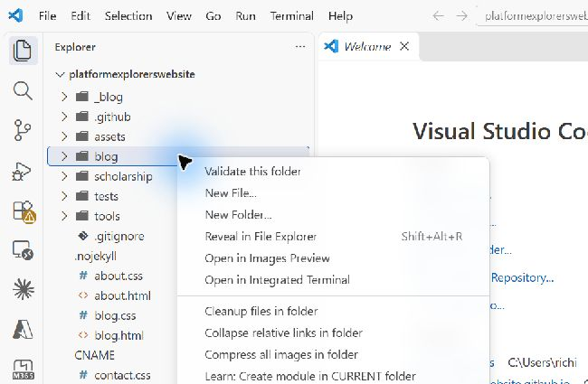](assets/contribution/vscode-new-folder-menu.webp)

*Right-click blog, then choose New Folder.*

3. Type `my-first-automation` and press **Enter**. Use your own article name
   in lowercase, with hyphens instead of spaces.

[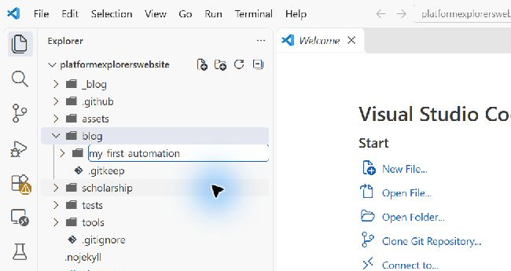](assets/contribution/vscode-folder-name.webp)

*Create one folder for your article inside blog.*

4. Right-click your new article folder, select **New File**, type `index.md`
   and press **Enter**.

[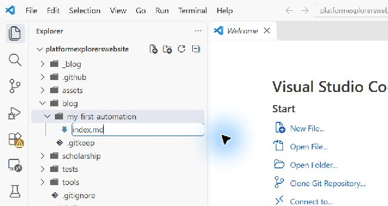](assets/contribution/vscode-new-article-file.webp)

*The article file belongs inside your new folder: blog/my-first-automation/index.md.*

5. In the Explorer, open **_blog > templates > post-template.md**. Click inside
   its text, select all with **Ctrl+A** and copy with **Ctrl+C** (use **Cmd**
   instead of Ctrl on macOS).

[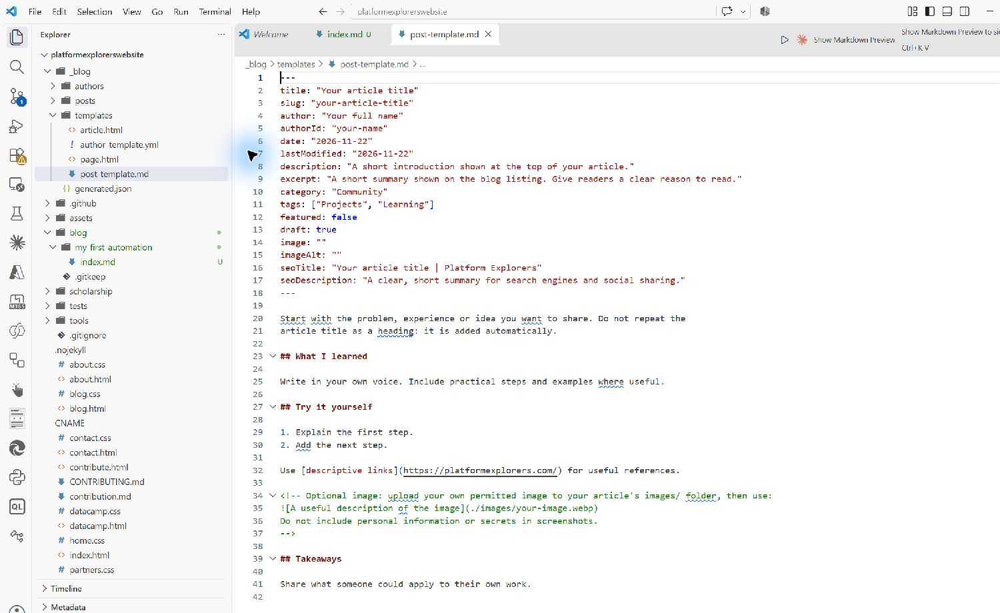](assets/contribution/vscode-post-template.webp)

*Copy the template's contents. Leave the template file itself unchanged.*

6. Open your new `index.md`, click inside the editor and paste the template.
7. Fill in the fields between the two `---` lines. Set `slug` to your article
   folder name, `author` to your full name and `authorId` to your author-profile
   filename without `.yml`. For a new article, set `date` and `lastModified`
   to the same date in `YYYY-MM-DD` format. Keep `draft: true` while writing.
8. Below the **second `---` line**, replace the sample text with your own
   article. Use `##` for section headings, then write your paragraphs beneath
   them. Save with **Ctrl+S** (**Cmd+S** on macOS).

[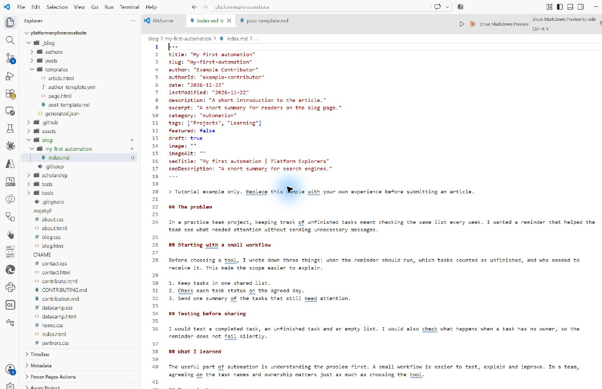](assets/contribution/vscode-article-details.webp)

*The example folder and slug match. Write your own article beneath the metadata.*

9. If you have images, right-click your article folder and select **New Folder**.
   Name it `images` and press **Enter**. Skip this if you have no images.

[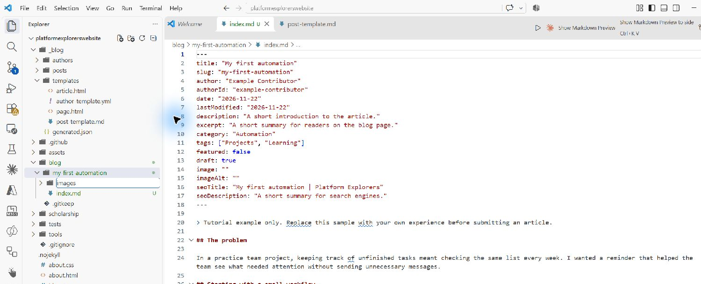](assets/contribution/vscode-images-folder.webp)

*Keep images inside your article folder, alongside index.md.*

10. Drag your image files from File Explorer (Finder on macOS) into that
    `images` folder in VS Code. Add each image to your article with its exact
    filename, for example:

```markdown

```

See [Article metadata and images](#article-metadata-and-images) at the end of
this guide for cover images and a reference for every field.

### 4. Add your author profile

Do this on your first contribution. For later articles, reuse your existing
profile and `authorId`.

1. Open **_blog > templates > author-template.yml**. Click inside the editor,
   select all and copy the contents.
2. In the Explorer, right-click **_blog > authors**, select **New File** and
   enter `example-contributor.yml`. Replace `example-contributor` with your own
   name in lowercase, with hyphens instead of spaces. Press **Enter**.

[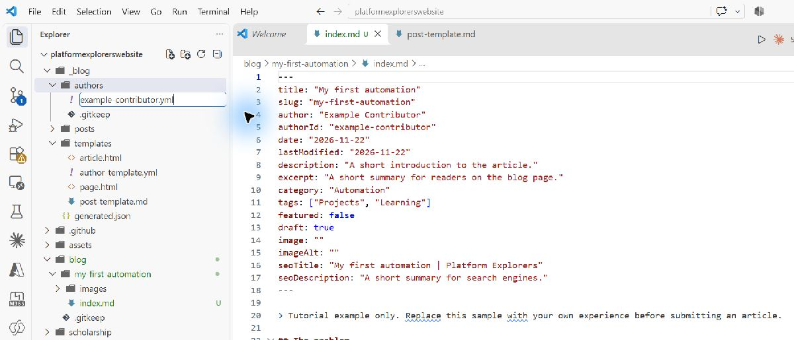](assets/contribution/vscode-new-author-file.webp)

*The filename must match the authorId in your article, followed by .yml.*

3. Paste the author template into the new file. Set `name` to exactly the same
   full name as your article's `author`. Write two or three sentences about
   yourself in `bio`. Leave `image` and `website` empty if you do not need them.
4. Save the file. Check that your article's `authorId` matches this filename
   without `.yml`.

[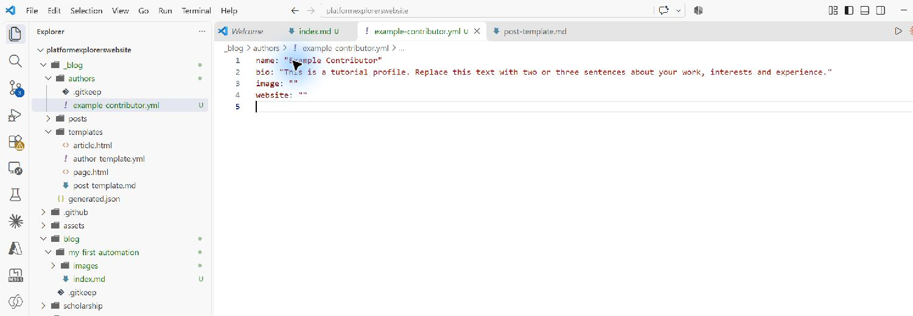](assets/contribution/vscode-author-profile.webp)

*The example profile uses Example Contributor, matching the article's author field.*

### 5. Check your article

1. Select **File > Save All**.
2. Open your article's `index.md`.
3. Select **Open Preview to the Side** at the top-right of the editor. Depending
   on your VS Code extensions, it may say **Show Markdown Preview to side**.
   You can also press **Ctrl+K**, release the keys, then press **V** (use
   **Cmd+K**, then **V** on macOS).

[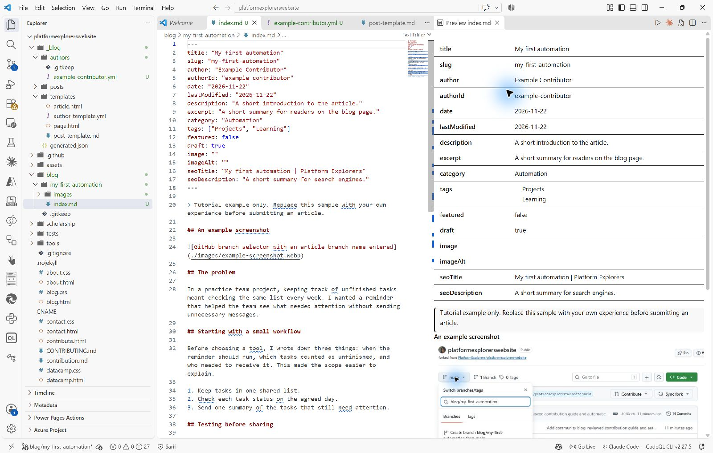](assets/contribution/vscode-preview-metadata.webp)

*The preview may show metadata as a table first. This is not the final website layout.*

4. Scroll down inside the preview to read the article below the metadata.
   Check the headings, paragraphs, links, spelling and images. If an image is
   missing, check its filename and the `./images/` path in your Markdown.

[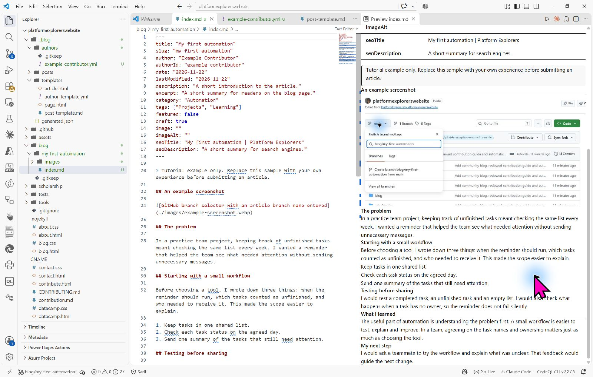](assets/contribution/vscode-preview-body.webp)

*Check the article body and images, not just the metadata at the top.*

5. When your article is ready for publication, set `draft: false` and save.
   Keep `draft: true` if you want feedback on an unfinished draft.

The website adds its own design, title, byline and author bio when the article
is built. You do not need to run the website locally to submit an article.

### 6. Save your changes to GitHub

1. Select **Source Control** in the left activity bar. Check that the changes
   contain your article, its images and your author profile if you added one.
   Open any file in the list to review it before committing.

[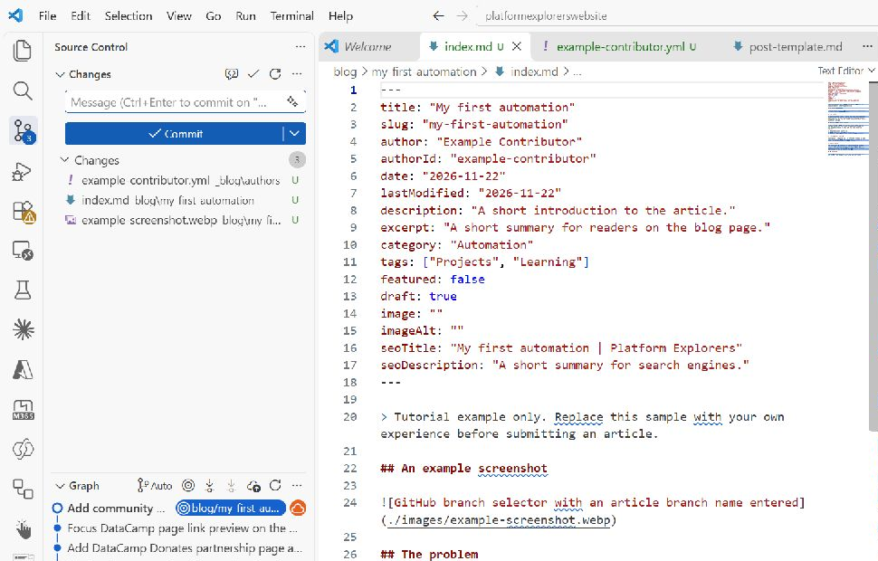](assets/contribution/vscode-review-changes.webp)

*For this example, there are three files: the article, one image and the author profile.*

2. Select **Terminal > New Terminal**. Run each command below separately,
   pressing **Enter** after each and waiting for it to finish. Use your own
   article folder and author-profile filename.

Select your article folder, including its images:

```shell
git add blog/my-first-automation/
```

Select your author profile if you created or changed it:

```shell
git add _blog/authors/example-contributor.yml
```

Save the selected files in a commit:

```shell
git commit -m "Blog: add my first automation article"
```

[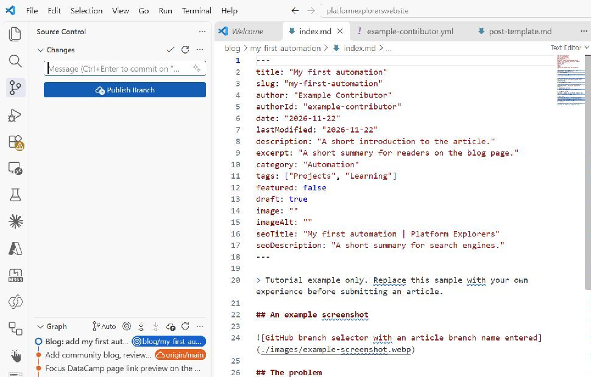](assets/contribution/vscode-local-commit.webp)

*After committing, the files are saved locally. Publish Branch indicates that the branch still needs uploading.*

Upload your branch to your fork:

```shell
git push -u origin blog/my-first-automation
```

Sign in to GitHub if asked. Wait until the upload finishes and the terminal
prompt returns. Open **your fork** in your browser and select your article
branch from the branch dropdown. Check that your article, images and author
profile are there. Uploading to your fork does not publish to the website.

If Git asks for your name and email before it can commit, run these commands
with your own details, then retry the commit:

```shell
git config user.name "Your Name"
git config user.email "your-github-email@example.com"
```

Use an email connected to your GitHub account, or the no-reply email shown in
your GitHub email settings. These details are attached to your commits.

### 7. Create your pull request

In your fork, select **Contribute > Open pull request**. Follow the screenshots
under [Open a pull request](#open-a-pull-request-vs-code-and-github) below to
check the destination, add your title and description, and submit it for review.

Use the same article branch for any requested changes. Save, commit and push
your edits to update the existing pull request.

## Option C: contribute directly on GitHub

Use this option to write and save your article in your browser. Start in **your
fork**, after completing the shared GitHub setup above.

The screenshots use the article folder `my-first-automation` and the author
`Example Contributor`. Replace these with your own article name and author
details, and use them consistently throughout.

### 1. Create your article branch

Open the dropdown that says **main**. Enter a branch name such as
`blog/my-first-automation`, then select **Create branch ... from main**.
Stay on this branch while adding your article, images and author profile.

[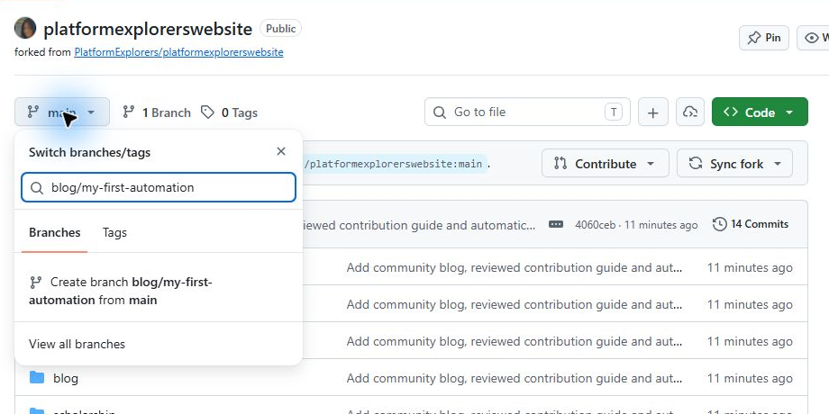](assets/contribution/create-branch.webp)

*The example branch is blog/my-first-automation, created from main.*

### 2. Open a new file

In your fork's file list, check that the branch dropdown shows your article
branch, such as `blog/my-first-automation`. Select **Add file**, then
**Create new file**.

[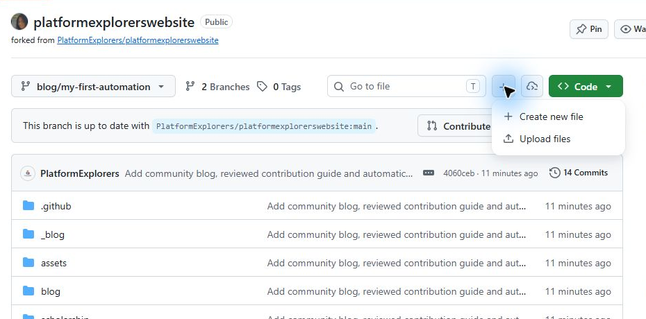](assets/contribution/add-file-menu.webp)

*Choose Create new file to open the article editor.*

### 3. Add the filename and article details

In **Name your file**, create the article folder and file like this:

1. Type `blog/` to put the file inside the website's blog folder.
2. Type your article folder name followed by `/`, for example
   `my-first-automation/`. When you type the slash, GitHub moves the folder name
   into the path above the editor.
3. Type `index.md` as the filename.

The complete path should be `blog/my-first-automation/index.md`. Use your own
article folder name, with lowercase words separated by hyphens. GitHub saves the
new folder and file together when you select **Commit changes** in step 6.

Open the [post template](_blog/templates/post-template.md) in a new browser tab.
On its GitHub page, select **Raw** to show the plain text. Select all that text
and copy it, then return to your new file and paste it into the editor.
Do not copy the formatted Preview view.

Fill in the article details between the two `---` lines. For a new article, set
`date` and `lastModified` to the same date in `YYYY-MM-DD` format.
The screenshot uses `slug: "my-first-automation"`, `author: "Example Contributor"`
and `authorId: "example-contributor"`.

Use your own values. The `slug` must match your article folder, and `authorId`
must match the author-profile filename you will add in step 9. Keep `draft: true`
while you are writing; change it to `false` when the article is ready for publication.

[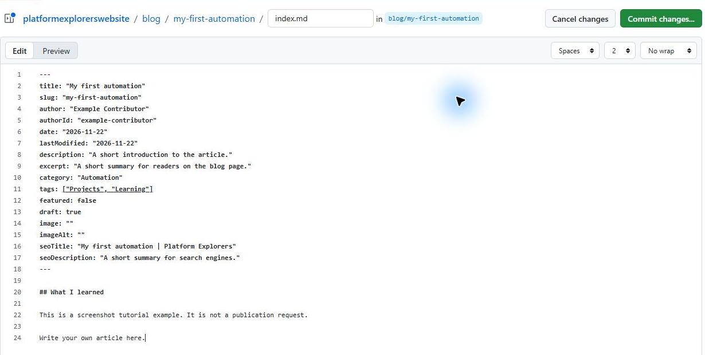](assets/contribution/article-editor.webp)

*The path, slug and author details in the screenshot belong to the same example article.*

### 4. Write the blog below the metadata

After the **second `---` line**, replace the template's sample text with your
article. Use `##` for section headings, then write your paragraphs underneath.
You can also add lists, links and examples.

The screenshot below shows the article text being written after the metadata.
Replace the tutorial write-up with your own article, blog or project story.

[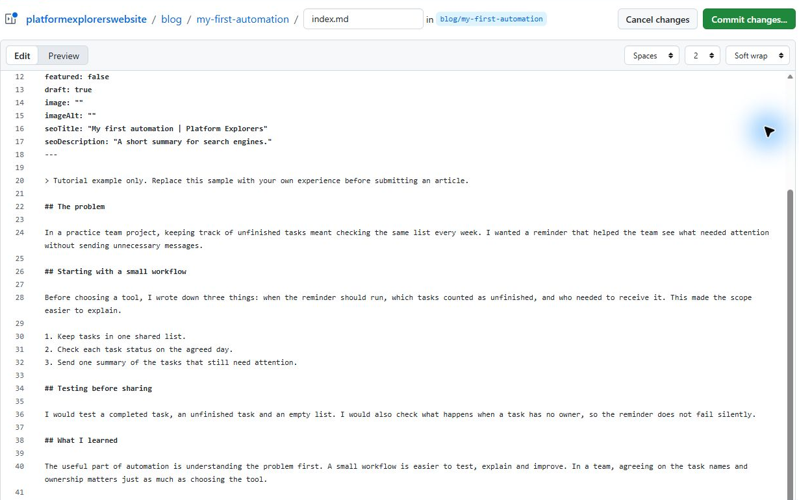](assets/contribution/blog-writeup.webp)

*Write your article below the closing --- line, as shown here.*

### 5. Preview the article

Select **Preview** beside **Edit**. GitHub displays the metadata as a table first.
This is expected; it is not the article's final website layout.

[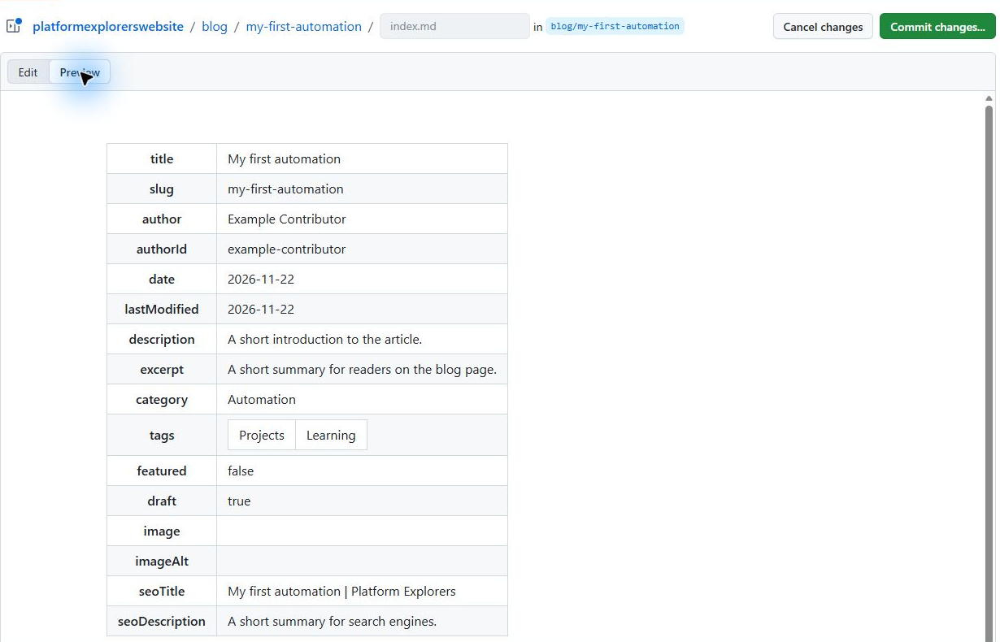](assets/contribution/article-preview.webp)

*The first part of the preview shows your metadata.*

Scroll **inside the preview** past that table to read the article text. Check
your headings, paragraphs, spelling and links. Return to **Edit** to make changes.

[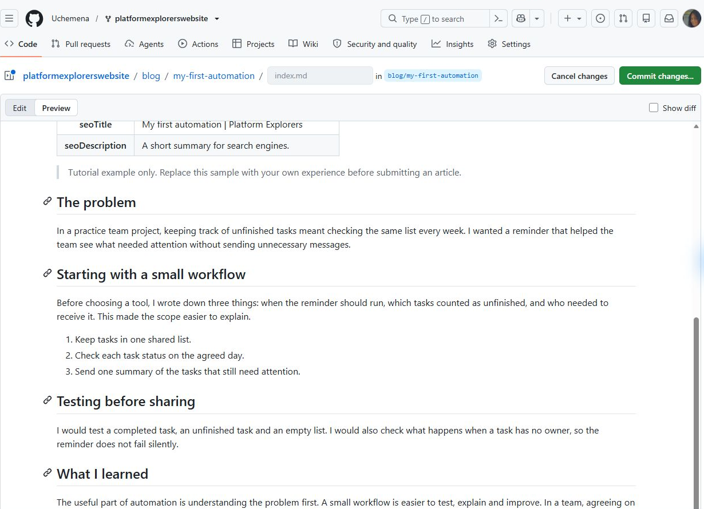](assets/contribution/blog-writeup-preview.webp)

*Below the table, the preview shows the actual blog text and headings.*

### 6. Save the article to your branch

Select **Commit changes** at the top of the editor. Enter a short message, such
as `Add my first automation article`. Keep **Commit directly to the
blog/my-first-automation branch** selected, using your own branch name.
Select **Commit changes** in the dialog to save.

[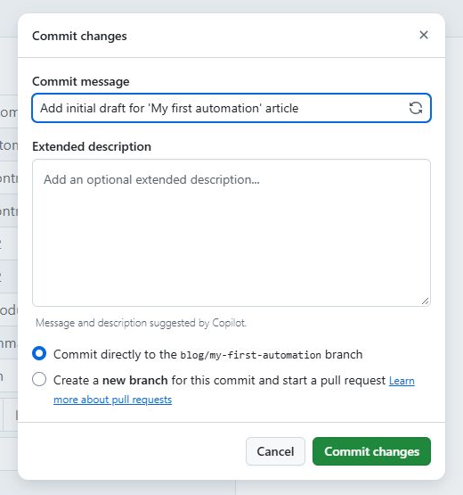](assets/contribution/commit-dialog.webp)

*Save to the branch you created in step 1. Do not create another branch for each file.*

### 7. Create an images folder, if needed

Skip steps 7 and 8 if your article has no images.

On your article branch, open `blog/`, then your article folder (the example is
`my-first-automation`). Select **Add file**, then
**Create new file**. Enter `images/.gitkeep` as the filename and leave the content
empty. GitHub moves `images` into the breadcrumb and leaves `.gitkeep` in the
filename field, as shown below.

Select **Commit changes** and save to the same article branch. This creates the
`images/` folder; `.gitkeep` is only an empty placeholder.

[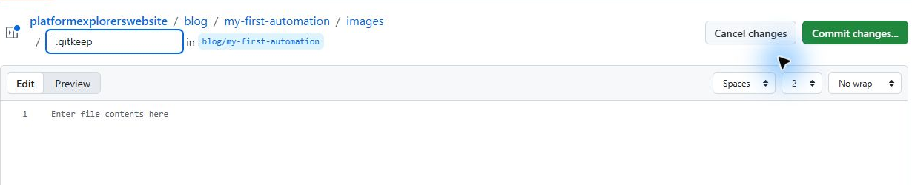](assets/contribution/create-images-folder.webp)

*Typing images/.gitkeep creates the images folder inside your article folder.*

### 8. Upload and reference your images

Open the new `images/` folder. Select **Add file**, then **Upload files**.
On the screen below, select **choose your files** or drag your images into the
upload area. Once the files appear in the upload list, enter a short commit message, keep
your article branch selected and select **Commit changes**. You can leave `.gitkeep` in the folder.

[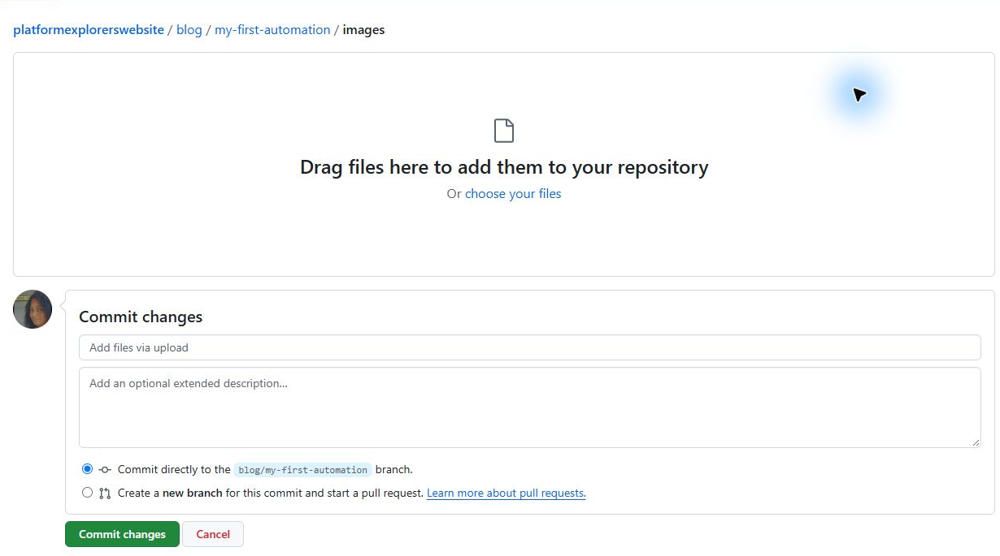](assets/contribution/upload-images.webp)

*The screenshot shows where to choose your image files before saving the upload.*

Return to your article's `index.md` on the same branch and select its pencil/edit
button. Image paths must match the uploaded filenames exactly, including the
file extension and capital letters. To place an image within your article, use
this example with your own filename and description:

```markdown

```

To show an image as the article's cover, fill in these two metadata fields
with your own filename and description:

```yaml
image: "./images/cover.webp"
imageAlt: "Describe what your cover image shows"
```

If you do not want a cover, leave `image: ""` and `imageAlt: ""`. Select
**Commit changes** to save your edits to the same article branch.

### 9. Add your author profile

For your first contribution, return to your fork's file list. Check that your
article branch is selected, then select **Add file**, followed by **Create new file**.

In **Name your file**, enter `_blog/authors/example-contributor.yml`, replacing
`example-contributor` with the `authorId` you used in your article.

Open the [author template](_blog/templates/author-template.yml) in another tab.
Select **Raw**, copy the plain text and paste it into your new profile file.
Set `name` to exactly the same name as the article's `author` field. Write two
or three sentences about yourself in `bio`. Leave `image` and `website` empty
if you do not want to add them.

[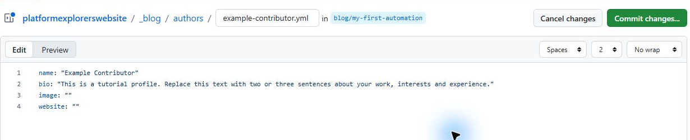](assets/contribution/author-profile.webp)

*The example profile filename matches authorId: example-contributor, and its name matches author: Example Contributor.*

Select **Commit changes** and save the profile to your article branch. On later
contributions, reuse your existing profile and `authorId`.

### 10. Open your pull request

Check that your article, any images and your author profile are saved on the
same branch. If the article is ready for publication, edit `index.md`, set
`draft: false` and commit that change. Keep `draft: true` if you are submitting
a draft for feedback.

Continue to [Open a pull request](#open-a-pull-request-vs-code-and-github) below
to send them to Platform Explorers for review.

## Your author profile

Complete this once, on your first contribution:

```yaml
name: "Your full name"
bio: "Two or three sentences about your work, interests and experience with your topic."
image: ""
website: ""
```

Save it as `_blog/authors/your-name.yml`. In the article, use:

```yaml
author: "Your full name"
authorId: "your-name"
```

The website adds **Written by** near the top of your article and **About the author**
with your bio at the end. Reuse the same `authorId` for future posts. You may update
your profile in a later PR. A public HTTPS profile link and portrait are optional.
For a reusable portrait, upload it to `assets/blog/` and use, for example,
`image: "/assets/blog/your-name.webp"`. Leave optional fields empty to omit them.
Only include information you want to appear publicly.

## Open a pull request (VS Code and GitHub)

### 1. Start the pull request from your fork

Open your fork on GitHub and select your article branch. Select **Contribute**,
then **Open pull request**, as shown below. You may also see a **Compare & pull
request** button above the files.

[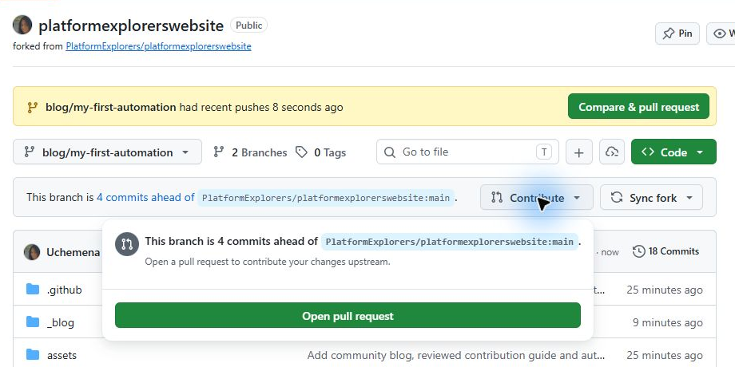](assets/contribution/open-pull-request.webp)

*Open the pull request from the branch containing your saved article files.*

### 2. Check where your changes will go

At the top of the comparison page, check these settings before continuing:

| Setting | Value |
| --- | --- |
| Base repository | `PlatformExplorers/platformexplorerswebsite` |
| Base branch | `main` |
| Head repository | Your fork |
| Compare branch | Your article branch, such as `blog/my-first-automation` |

[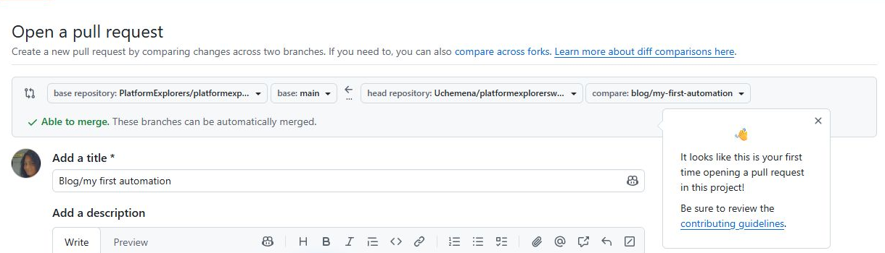](assets/contribution/pull-request-comparison.webp)

*The left side is the Platform Explorers destination. The right side is your fork and article branch.*

### 3. Fill in the form and submit

Add a title, such as `Blog: My first automation`, and a short description of your
article. Complete the checklist in the description. Review the changed files
shown below the form: include your article, its images and your new or updated
author profile.

When your article is ready, check that its metadata has `draft: false`, then
select **Create pull request**. If you are still working on it, keep `draft: true`
and choose **Create draft pull request** from the dropdown beside that button.

[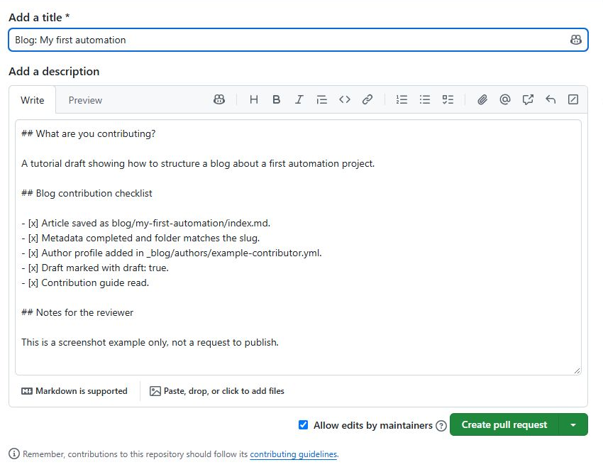](assets/contribution/pull-request-form.webp)

*Fill in your own article details. This screenshot is a tutorial example; its form was not submitted.*

Watch the PR's checks and comments. If a check fails, open its build log and find
the filename and error. Fix the file on **the same branch** in VS Code or GitHub,
commit and push/save. The existing PR updates automatically; do not open another.
If this is your first contribution, a maintainer may need to approve the automated
checks before they run.

Opening a PR does not publish your article. After a maintainer approves and merges
a ready post, the build creates its HTML page, updates `blog.html` and the sitemap,
and deploys the website. A draft remains hidden. Keep an existing post's slug
unchanged so its published links continue working.

## Before you submit through GitHub

- [ ] My article is `blog/my-article/index.md` and the folder matches its `slug`.
- [ ] I used the post template and filled in every required metadata field.
- [ ] I added or reused an author profile with a publication-ready bio.
- [ ] My images are in my article's `images/` folder, with working paths and alt text.
- [ ] I have permission to publish the content and images, and credited sources.
- [ ] I checked formatting, links and private information.
- [ ] I set `draft` correctly and included only the intended files in my PR.

## Further help

- [VS Code: cloning repositories](https://code.visualstudio.com/docs/sourcecontrol/repos-remotes)
- [VS Code: branches and publishing a branch](https://code.visualstudio.com/docs/sourcecontrol/branches-worktrees)
- [GitHub: opening a pull request from a fork](https://docs.github.com/en/pull-requests/how-tos/create-pull-requests/creating-a-pull-request-from-a-fork)

## Article metadata and images

These fields are for the VS Code and GitHub options. They are not required for
a Word document sent by email.

Keep the metadata between the two `---` lines at the start of `index.md`.
Set `slug` to the article folder name. These must match. For a local image:

```yaml
slug: "my-first-automation"
image: "./images/cover.webp"
imageAlt: "Describe what the cover image shows"
```

To insert an image in the article body:

```markdown

```

Use lowercase, hyphenated filenames. Supported image formats are JPG, JPEG, PNG,
WebP and GIF; aim for under 500 KB per image. Keep image paths inside your article's
`images/` folder. Do not use paths from your computer such as `C:\Users\...`.
If you do not need a cover, keep `image: ""` and `imageAlt: ""`.

| Field | What to enter |
| --- | --- |
| `title` | The visible article headline. |
| `slug` | Unique lowercase words separated by hyphens. Becomes `/blog/your-slug/`. Keep it unchanged after publication so existing links keep working. |
| `author` | Your full name, exactly as it appears in your author profile. |
| `authorId` | Your profile filename without `.yml`, for example `rachel-irabor`. |
| `date` | Original publication date in quoted `YYYY-MM-DD` format. |
| `lastModified` | Date of the latest edit, on or after `date`. |
| `description` | Short introduction displayed at the top of the article. |
| `excerpt` | Summary displayed on the blog listing. |
| `category` | One clear topic, such as Automation, Career or Community. |
| `tags` | A list such as `["Power Automate", "SharePoint"]`. |
| `featured` | `true` to show a Featured label; otherwise `false`. |
| `draft` | `true` hides the post from the public site. Set `false` when ready for review and publication. |
| `image` | Optional cover image, e.g. `./images/cover.webp`. Leave `""` to omit. |
| `imageAlt` | Describe the cover image for readers who cannot see it. Required when an image is supplied. |
| `seoTitle` | Search and browser title, usually your headline plus Platform Explorers. |
| `seoDescription` | A concise, accurate summary for search engines and shared links. |

Write sections with `## Heading` and subsections with `### Heading`. Do not repeat
the article title, byline or author bio in the body; the website adds them.
Use descriptive links, readable paragraphs, lists and fenced code blocks where
helpful. Use Markdown rather than raw HTML. Scripts, iframes, forms and unsafe
links are removed during the build.

Credit sources and any images that require attribution. Check facts and links,
and remove credentials or private information from examples and screenshots.

## Maintainer notes

- On the owner's local project, this repository content lives in `dist/`; run
  `python -m pip install -r dist/requirements-blog.txt` once, then `python dev.py --open`.
  The live preview automatically rebuilds Markdown and refreshes the browser.
- The root of the GitHub repository corresponds to the **contents** of `dist/`.
  Publish the source folders, templates, requirements, tests and `.github/` too.
- At the first approved publication, set repository **Settings → Pages → Build
  and deployment → Source → GitHub Actions**. Keep the custom domain
  `platformexplorers.com` and HTTPS. The workflow preserves `CNAME` and `.nojekyll`.
- Make the `build` job a required PR check in branch protection if desired.
  Keep reviews required before merging. Fork PR builds have read-only permission
  and do not receive deployment credentials.
- The workflow builds a clean public artifact excluding Markdown sources,
  tools and tests. Generated pages do not need a bot commit back to the repository.
- Shared blog HTML is in `_blog/templates/page.html` and `article.html`.
  `blog.css` controls the blog design. Apply shared header/footer changes in the
  page template too. `tools/build_blog.py` rebuilds the listing, posts and sitemap.
- Removing a post or returning it to draft removes only its previously generated
  page on the next build. `date` is metadata, **not** a publishing schedule;
  use `draft: true` to keep a post unpublished.
- Never merge a ready post until its author bio, rights, links and content have
  been reviewed. No application data or private information belongs in this repo.
